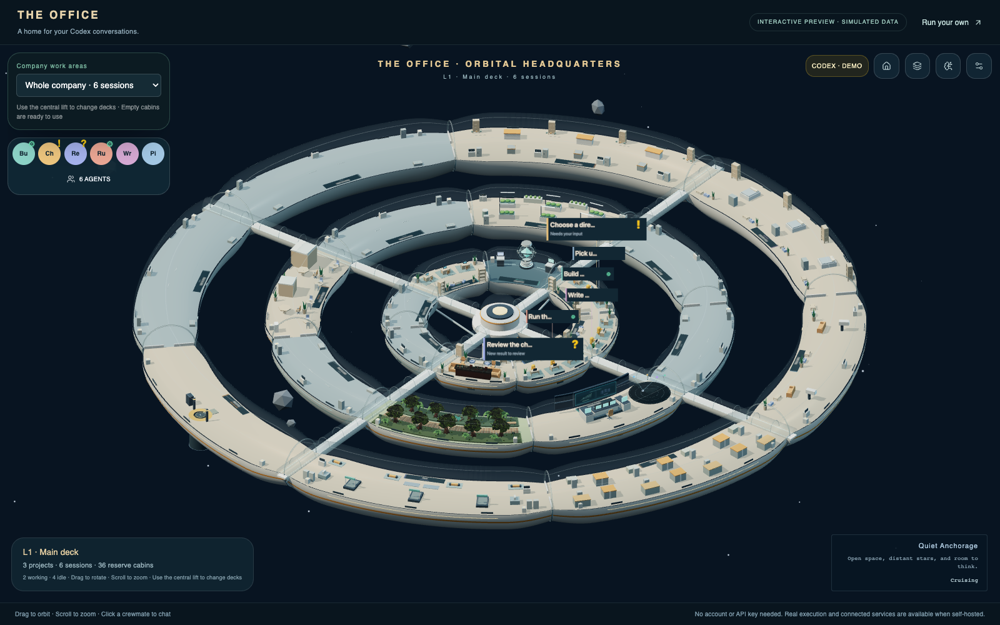
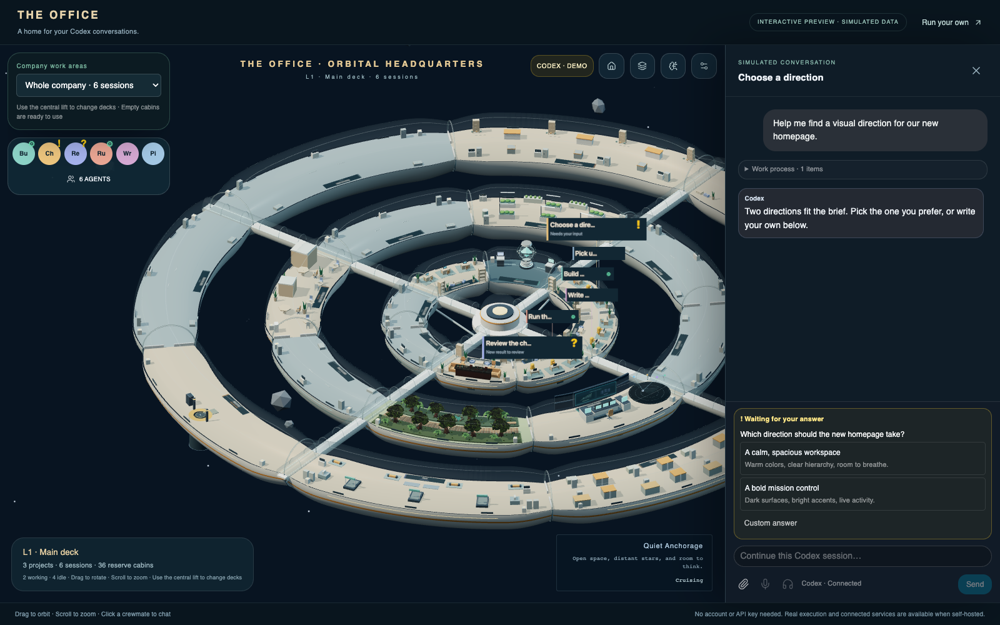
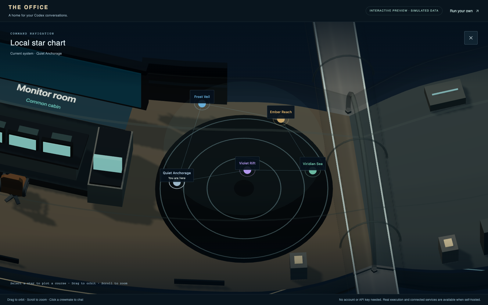

<h1 align="center">The Office</h1>

<p align="center">
  <strong>Your Codex conversations, brought to life.</strong><br>
  A self-hosted 3D workspace where projects have rooms and conversations have crewmates.
</p>

<p align="center">
  <a href="https://aurthes.github.io/the-office/"><strong>▶ Try the live demo</strong></a> ·
  <a href="#quick-start">Run locally</a> ·
  <a href="docs/office-owned-state.md">Connect Codex</a> ·
  <a href="docs/operations.md">Self-hosting guide</a>
</p>

<p align="center">
  <a href="LICENSE"></a>
  
  
</p>

[](https://aurthes.github.io/the-office/)

<p align="center"><em>Real application components, fictional projects. Open the demo, drag to orbit, and click a crewmate.</em></p>

You have more than one conversation going. A feature to build, a change to
review, a question waiting for an answer. **The Office gives that work a place.**
Look around, see who needs you, and jump straight into the conversation.

## Take a look

| Talk to your crewmates | Explore the ship |
| --- | --- |
|  |  |
| Chat, read the work log, and answer a question with one click. | Move between decks, visit shared spaces, and plot a course. |

[See the three-deck view →](docs/images/office-whole-ship.png)

**[Open the interactive demo →](https://aurthes.github.io/the-office/)** No login,
installation, or API key. Try the scene, sample conversations, choice cards, and
interrupted-task Play button. Responses are simulated; real model execution,
voice and connected services require your own installation.

## What makes it useful

- **Conversations you can see.** Each crewmate is a conversation, grouped into
  project work areas. Yellow **!** means input is needed; yellow **?** means a new
  result is ready to review.
- **A proper place to work.** Streaming chat, readable Markdown, collapsible tool
  activity, uploads, image paste, and supported file previews.
- **Fewer clicks to keep moving.** Click a suggested answer to send it, or write
  your own. Stopped task? Press **▶** to continue in the same conversation.
- **Your own Codex workspace.** Office owns its projects, sessions, login and
  runtime. Choose models and access levels, and handle approvals in the chat.
- **Experimental live voice.** Start a call through your Office Codex login.
  Account support and limits apply. Optional dictation and prompt suggestions
  use a separately configured OpenAI API key.
- **An office worth exploring.** Three decks, duck crewmates, shared spaces, a
  listening bar, star navigation, an AI Center and configurable monitor shortcuts.

The interface supports **English and 简体中文**. Switch in Settings; your projects
and conversation content stay as written.

## Quick start

Use **Node.js 24** and npm:

```sh
git clone https://github.com/Aurthes/the-office.git
cd the-office
npm ci
npm run demo:dev
```

Open the URL printed in the terminal. This runs the same browser-only preview as
the public demo, with simulated projects and conversations.

### Ready for real work?

Follow **[Connect Codex: setup and tested features](docs/office-owned-state.md#setup)**
to start Office's independent Codex runtime and Studio. The pinned official
Codex CLI is included with `npm ci`; no OpenClaw installation is required.
Authorize your account in Office, create a project, and start a conversation.

Public Codex rules, standalone skills and selected ordinary defaults are
automatically discovered. Native Codex/ChatGPT App conversations, credentials and
private state stay separate. The [feature map](docs/office-owned-state.md#chat-feature-map)
records tested behavior and current limits. Codex app-server and live voice are
experimental interfaces.

The original local demo gateway remains available with
`npm run demo-gateway` and `npm run dev`; select **Demo** and connect to
`ws://localhost:18789`.

## Documentation

| I want to… | Start here |
| --- | --- |
| Set up real Codex projects and chats | [Office-owned runtime](docs/office-owned-state.md) |
| Configure AI Center, monitors or server metrics | [Self-hosted operations](docs/operations.md) |
| Access my Office remotely | [Web access](docs/web-access.md) · [Two-factor authentication](docs/web-access-2fa.md) |
| Understand security and integration boundaries | [Security](SECURITY.md) · [Codex integration](docs/codex-integration-boundary.md) |
| Build or update the public preview | [Demo source and publishing](demo/README.md) |

## Development

```sh
npm run typecheck
npm test -- --run
npm run build       # Self-hosted app
npm run demo:build  # Public preview → dist-demo/
```

Dependencies are pinned in `package-lock.json`. The inherited test suite and full
lint command have existing findings; focused acceptance commands are documented
alongside their features. The public demo publishes through GitHub Actions when
its source or assets change on `main`.

## Built on Claw3D

The Office is independently maintained by **[Aurthes](https://github.com/Aurthes)**
and built on **[Claw3D](https://github.com/iamlukethedev/Claw3D)**, originally
created by **[Luke The Dev](https://github.com/iamlukethedev)**. It is an unofficial
community project, not an official OpenAI, OpenClaw or Claw3D product.

Code is **[MIT licensed](LICENSE)**, preserving the upstream copyright notice.
Bundled assets retain their own licenses; furniture is Kenney CC0 and the
Poly Haven environment map is CC0. See [third-party notices](THIRD_PARTY_NOTICES.md).
Our stable branch is `Aurthes/the-office:main`; the original Claw3D repository is
a read-only upstream. Screenshots use simulated content, not private account data.
