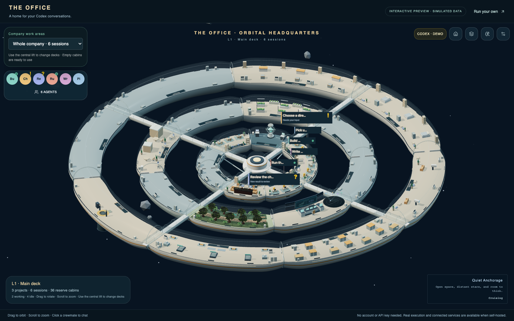

# The Office

A 3D workspace for your Codex conversations.

**[Download for Mac — Apple Silicon preview](https://github.com/Aurthes/the-office/releases/download/v0.1.4-preview.1/The-Office-0.1.4-macOS-arm64.dmg)**

For **M1 or newer**, macOS 13.5+, and a ChatGPT account with Codex access.
Node and Codex are included. No terminal or manual gateway setup.

> **Developer preview:** Apple signing and notarization are not finished.
> macOS may block the app. [How to open the preview](docs/macos-install.md#if-macos-blocks-the-preview).

## Get started

1. **Install.** Open the DMG, drag **The Office** to **Applications**, then open it.
2. **Sign in.** In Office, click **Sign in with ChatGPT** and finish signing in.
3. **Start working.** Recruit an agent, choose a working folder, give it a name, and send a message.

Office asks you to sign in separately from the Codex App and keeps its own chats.
Music, server dashboards and other integrations are optional.

## Try it in your browser

**[Open the demo](https://aurthes.github.io/the-office/)** — no installation or login.
The demo uses sample conversations and simulated replies.

## Help and development

- [Install, troubleshoot or build the Mac app](docs/macos-install.md)
- [Run from source and connect Codex](docs/office-owned-state.md#setup)
- [Connect optional services](docs/operations.md) · [Remote access](docs/web-access.md)
- [Demo source](demo/README.md) · [Security](SECURITY.md)

---

Built on [Claw3D](https://github.com/iamlukethedev/Claw3D), originally by
[Luke The Dev](https://github.com/iamlukethedev), and independently maintained by
[Aurthes](https://github.com/Aurthes). Unofficial community project, not an OpenAI product.
[MIT license](LICENSE) · [Third-party notices](THIRD_PARTY_NOTICES.md).
