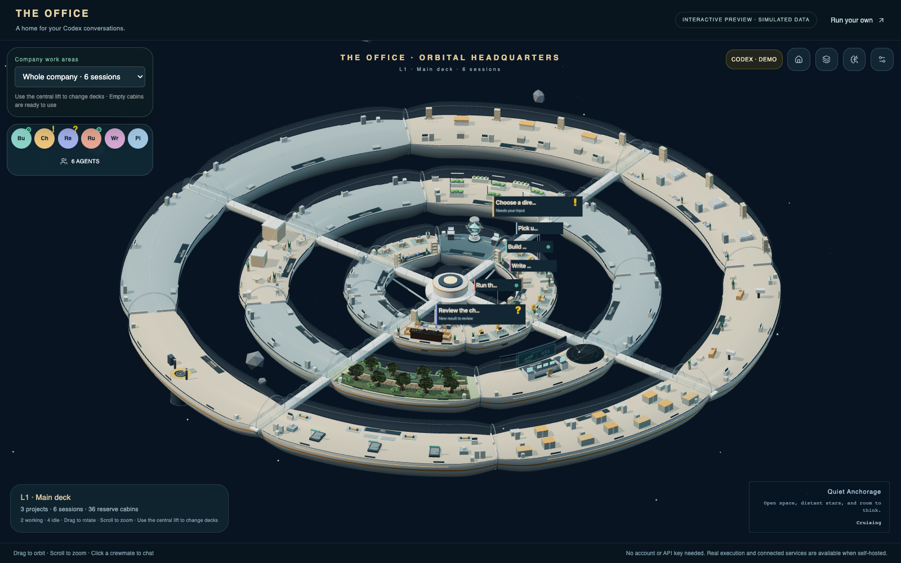

# The Office

A 3D workspace for your Codex conversations.

**[Download for Mac — Apple Silicon preview](https://github.com/Aurthes/the-office/releases/download/v0.1.4-preview.1/The-Office-0.1.4-macOS-arm64.dmg)**

For **M1 or newer**, macOS 13.5+, and a ChatGPT account with Codex access.
Node and Codex are included. No terminal or manual gateway setup.

> **Developer preview:** Apple signing and notarization are not finished.
> macOS may block the app. [How to open the preview](docs/macos-install.md#if-macos-blocks-the-preview).

## Get started

1. **Install.** Open the DMG, drag **The Office** to **Applications**, then open it.
2. **Sign in.** In Office, click **Sign in with ChatGPT** and finish signing in.
3. **Start working.** Recruit an agent, choose a working folder, give it a name, and send a message.

Office asks you to sign in separately from the Codex App and keeps its own chats.
Music, server dashboards and other integrations are optional.

## Try it in your browser

**[Open the demo](https://aurthes.github.io/the-office/)** — no installation or login.
The demo uses sample conversations and simulated replies.

## Help and development

- [Install, troubleshoot or build the Mac app](docs/macos-install.md)
- [Run from source and connect Codex](docs/office-owned-state.md#setup)
- [Connect optional services](docs/operations.md) · [Remote access](docs/web-access.md)
- [Demo source](demo/README.md) · [Security](SECURITY.md)

---

Built on [Claw3D](https://github.com/iamlukethedev/Claw3D), originally by
[Luke The Dev](https://github.com/iamlukethedev), and independently maintained by
[Aurthes](https://github.com/Aurthes). Unofficial community project, not an OpenAI product.
[MIT license](LICENSE) · [Third-party notices](THIRD_PARTY_NOTICES.md).

### Independent task phases

New Office tasks use independent phases: one Owner coordinates the goal, and each phase has its own assigned agent, timer, handoff and review. Use each phase row to start work, pause timing or open its conversation. Controls appear on hover or keyboard focus and remain visible on touch devices. Different agents can work in parallel; completing one phase does not start another. Displayed time is cumulative phase work, not elapsed wall time or an individual's hours.

Running means an agent is still responsible for following the work, including an asynchronous job. Turn completion, task switching and Office restarts stop activity timing without pausing that responsibility. Pause explicitly when follow-up stops; only an explicit decision request is shown as needing the user. Older automatically paused records are not guessed or mass-restored. A targeted `todo_edit` status update can record confirmed follow-up without starting a timer or model call; existing execution or working-handoff identity is required. Task progress prioritizes current phases and keeps completed history expandable.

Task Progress in the chat Workspace lists Running work first, recent recorded progress next, and other follow-up last. Its recent window defaults to one hour and is remembered in the browser. Recently completed or archived work stays in that window; document edits and system timer stops do not count as progress. History reads are bounded to the newest 200 archived tasks, with a notice when limited, and do not change assignment badges or department counts. Older work remains available through the task history.

Phase-mode tool calls require an explicit `phaseId`; submissions, reviews and recalls also require the exact `handoffId` from the notification or task record. Managers retain acceptance through the actual reporting chain. The legitimately completed final phase archives the task once every phase is complete and no handoff remains open, without another parent approval step.

Existing tasks keep their original whole-task workflow and recorded history. To configure future phases independently, finish old handoffs and pause the timer, then explicitly choose independent assignments. Existing completed phases keep their IDs and recorded time; missing historical assignees remain unknown. The Owner coordinates assignments without restricting ordinary member or user edits.

### Important task reminders

Department Heads can explicitly use `office_tasks.important_notify` with a stable
`eventId` and short saved brief for verified useful results, decisions or real
blockers. Routine progress and worker submission do not automatically notify.
Updates to the same event replace its notification. Reading a brief makes no model
request; its separate voice button starts the existing call only after a click.

Installed app labels distinguish local/private entry hosts (**Office · LAN**, LAN badge) from public entry hosts (**Office · Remote**, NET badge). Existing installations may retain their old name/icon; reinstalling can require login and notification permission again. The manifest identity, launch URL and scope remain unchanged.

Enable notifications in **Settings → Notifications**. iPhone requires iOS 16.4+
and opening Office from **Safari → Share → Add to Home Screen** before enabling.
The current site address is the installation boundary: changing it requires a new
Home Screen installation, permission and subscription. Delivery remains subject
to browser permission, Focus and network conditions; push-service acceptance is
not proof of lock-screen display. Actual iPhone delivery requires a device check.

This uses standard Web Push and a notification-only service worker, without
an offline cache. Lock-screen payloads contain only an opaque reminder ID and
generic text; details require the existing website login. Single-owner identity
and installation binding use the existing trusted Auth proxy, including logout
and password/MFA version invalidation. Gateway and Auth must share the existing
`CLAW3D_PROXY_TOKEN`; the Auth loopback port is `CLAW3D_ACCESS_PORT` (default 3035).
Native shared-service `actorId` remains an actor convention, not individual
cryptographic authentication. No third-party callback URLs are accepted.

Private Gateway files `push-vapid.json` and `important-notifications.json` retain
keys, subscriptions and bounded retry state across restart. Protect them like
other private runtime state; do not rotate/delete keys as a routine upgrade.
Push delivery has bounded retries and expiry; 404/410 subscriptions are retired.
Notification tags mitigate crash-window duplicate delivery, without claiming
exactly-once delivery. Corrupt reminder state disables reminders while leaving
chat available. No automatic microphone access, phone call or paid synthesis is
triggered by a notification.
